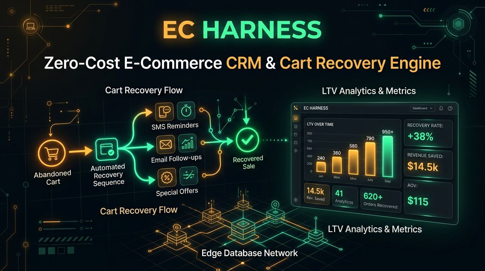

# EC Harness 🛒


> **月額数万円のKlaviyo・Omnisendを代替する、月額0円・AIネイティブなEC/D2C特化型カゴ落ち回収＆LTV最大化CRMエンジン**  
> *Cloudflare Workers × D1 Database × Shopify/BASE Webhook × LINE & Resend × MCP (Model Context Protocol)*

---

## 💡 なぜ「EC Harness」なのか？

ShopifyやBASE、自社ECを運営するD2C・EC事業者にとって、**「カゴ落ち（カートに入れたまま離脱される70%の機会損失）」**と**「高額なEC向けMA/CRMツールの固定費」**は最大の課題です。

| ツール | 月額費用 | 課題・ペイン |
| :--- | :--- | :--- |
| **Klaviyo / Omnisend** | 月額 $45〜$500+ | 顧客リストが増えるだけで毎月数万〜十数万円の課金が発生 |
| **EC専用LINE連携SaaS** | 月額 1.5万〜5万円 | ID連携やカゴ落ち通知のためだけに高額な基本料が必要 |
| **🔥 EC Harness** | **実質 ¥0** | **Cloudflare無料枠＋Resend無料枠（月3,000通）＋LINEで完結。自社D1で顧客LTVを完全掌握。** |

---

## 🌟 主な機能

1. **カゴ落ち自動検知 ＆ クーポン付き追客配信（LINE / メール両対応）**
   - Shopify / BASE / カスタムECのチェックアウトWebhookを受信。
   - 決済未完了のカートに対し、限定割引コード（例: `COMEBACK10`）付きのフォロー通知をLINEまたはメール（Resend）で自動配信。
2. **購入後ステップ配信の自動スケジューリング**
   - 購入直後: サンクスメッセージ配信
   - 7日後: 商品到着後のレビュー・UGC投稿依頼
   - 30日後: 消耗品のリピート購入・クロスセル案内
3. **RFM分析・LTVセグメンテーションの自動計算**
   - 累計購入額・購入回数・最終購入日から顧客を `VIP` / `Loyal` / `Promising` / `At Risk` に自動分類。
4. **AIエージェントネイティブ（MCP対応）**
   - Claude Code や Cursor から自然言語でECのCRM運用が可能：
   - 例: `「現在カゴ落ちしているカート一覧と回収見込み金額を教えて」`
   - 例: `「1万円以上のカゴ落ち顧客全員に10%OFFクーポン付きリカバリー通知を送って」`
   - 例: `「VIP顧客と休眠予備軍（At Risk）の売上比率を出して」`

---

## 🚀 クイックスタート（5分でデプロイ）

```bash
npm install
npx wrangler d1 create ec-crm-db
# wrangler.toml に database_id を設定後:
npm run d1:remote
npm run deploy
```

### ローカル開発・デモ確認
```bash
npm run dev
# http://localhost:8788 でリアルタイムダッシュボードが起動します
```
